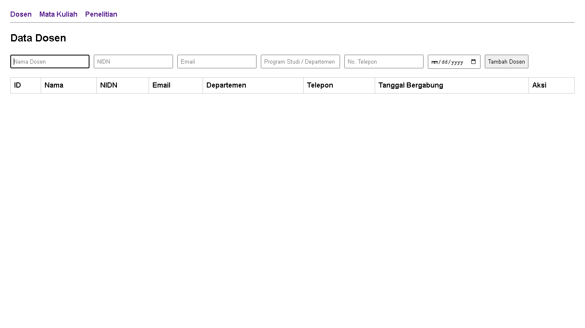
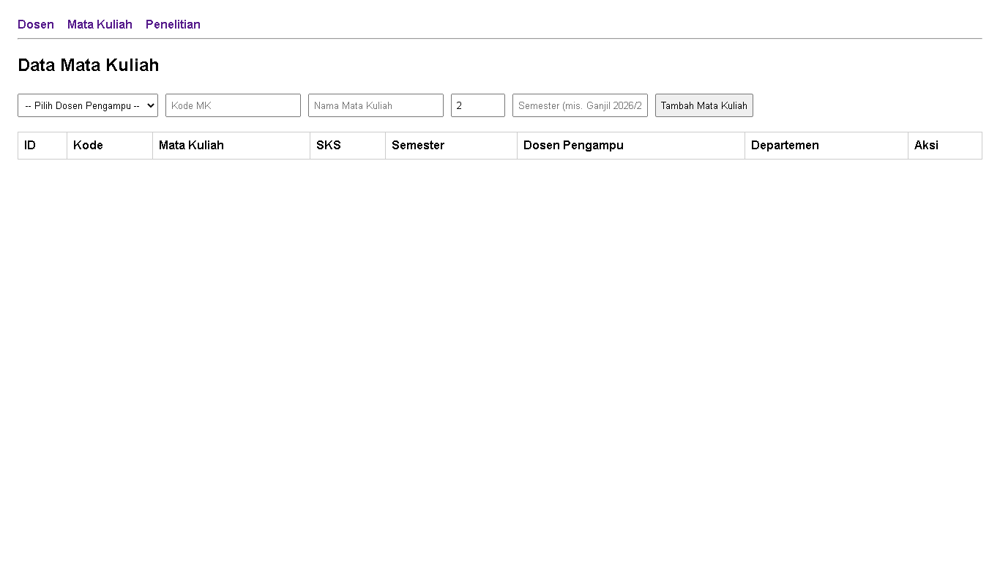
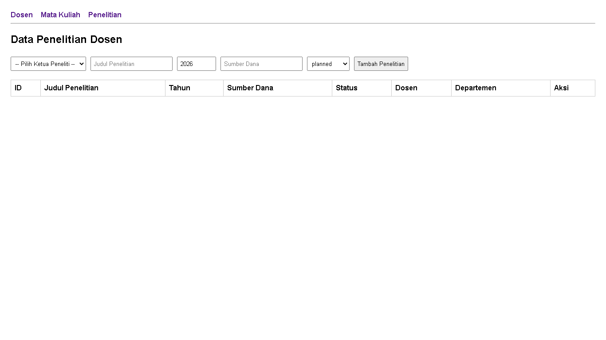
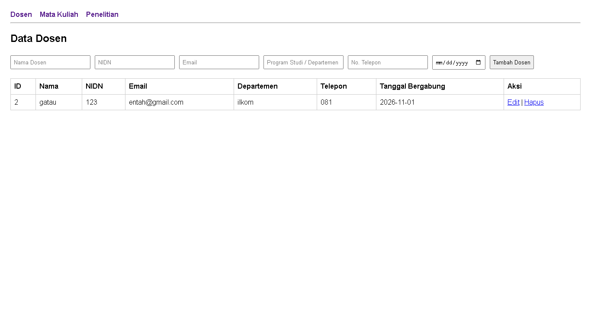
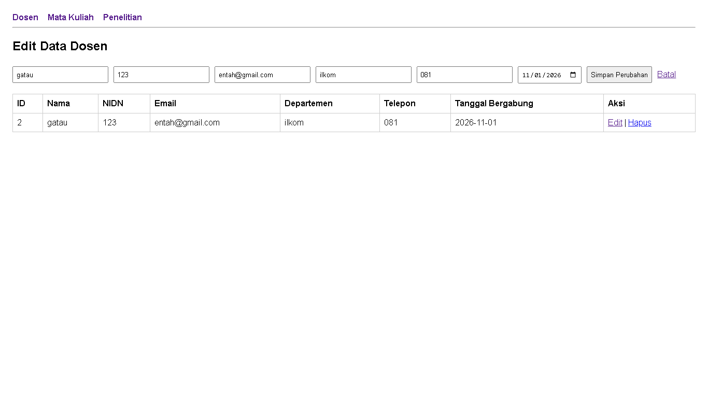
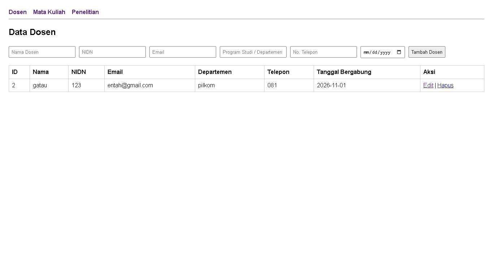
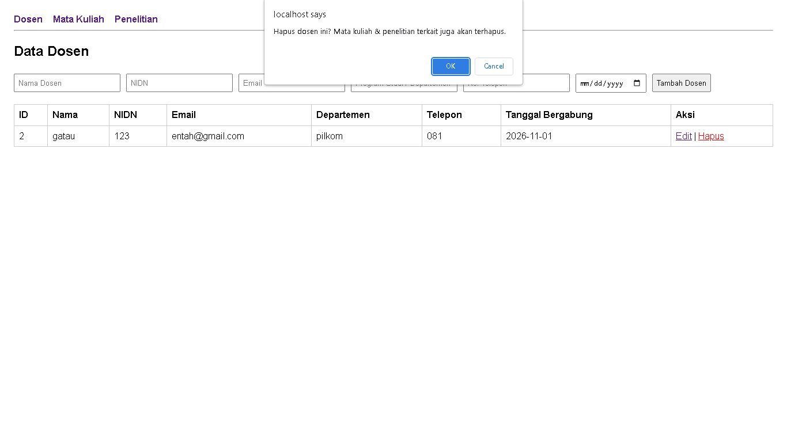

# TP8DPBO2526C1
## JANJI
Saya Louis Marcel Wendy Adrianto dengan NIM 2509068 mengerjakan Tugas Praktikum 8 pada Mata Kuliah Desain dan Pemrograman Berorientasi Objek (DPBO) untuk keberkahan-Nya maka saya tidak melakukan kecurangan seperti yang telah dispesifikasikan. Aamiin

## STRUKTUR MVC DAN PENJELASAN
```
tp_mvc25/
├── config/
│   └── Database.php
├── controllers/
│   ├── LecturerController.php
│   ├── CourseController.php
│   └── ResearchProjectController.php
├── models/
│   ├── Lecturer.php
│   ├── Course.php
│   └── ResearchProject.php
├── views/
│   ├── layout/
│   │   ├── header.php
│   │   └── footer.php
│   ├── lecturers/
│   │   └── index.php
│   ├── courses/
│   │   └── index.php
│   └── research_projects/
│       └── index.php
└── index.php
```
### CONFIG
Mengelola konfigurasi kredensial database dan menyediakan instance koneksi agar bisa dipakai oleh model tanpa menulis ulang koneksi.
### CONTROLLER
Menjadi penghubung antara Model dan View. Menerima input dari request ($_GET/$_POST), memanggil method di Model, menyiapkan data, mengarahkan ke View, atau melakukan redirect.
### VIEWS
Menyajikan antarmuka pengguna (HTML/PHP). Menampilkan data yang dikirim Controller serta memuat komponen bersama seperti header.php dan footer.php di folder layout/.
### MODELS
Mengurus data dan komunikasi dengan database (query SQL, prepared statements, serta operasi CRUD seperti getAll, findById, create, update, dan delete). Tidak mengatur tampilan HTML.
### INDEX.PHP
Titik masuk utama setiap request HTTP. Membaca parameter page dan action dari URL, lalu meneruskannya ke controller yang sesuai.


## ALUR
1. Pengguna membuka URL (misalnya index.php?page=courses&action=index).
2. index.php membaca parameter page dan action, lalu memanggil CourseController::index().
3. CourseController meminta data mata kuliah dan daftar dosen melalui Course dan Lecturer di folder models/.
4. CourseController meneruskan data tersebut ke views/courses/index.php (yang juga menyertakan views/layout/header.php dan views/layout/footer.php) untuk dirender menjadi halaman HTML di browser.

## DOKUMENTASI







